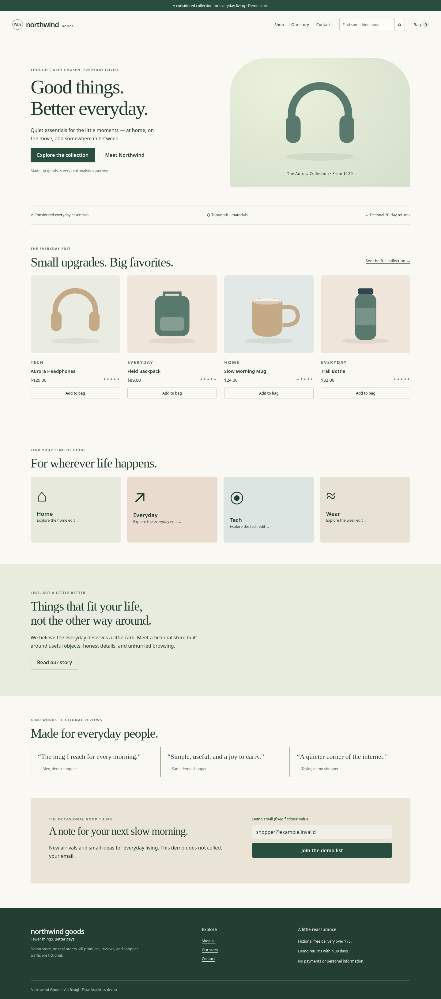
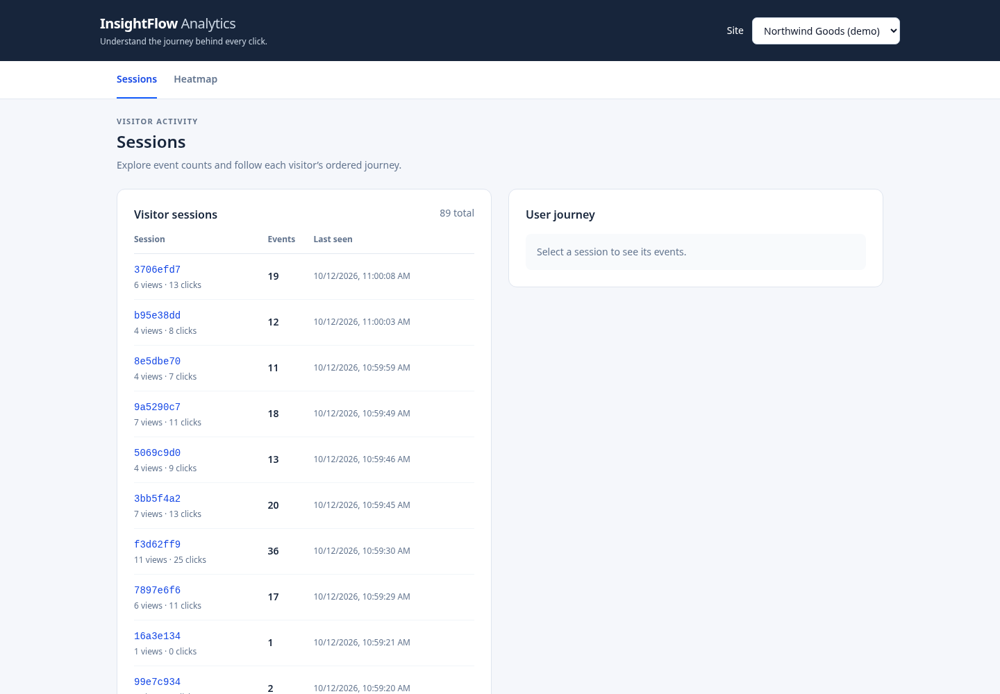
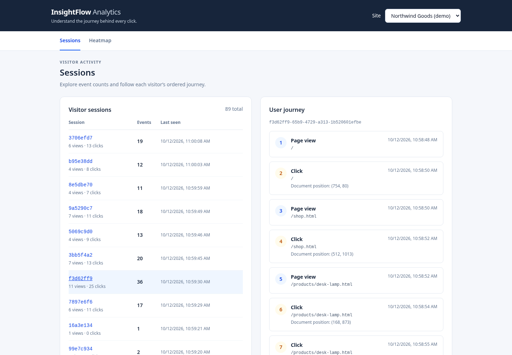
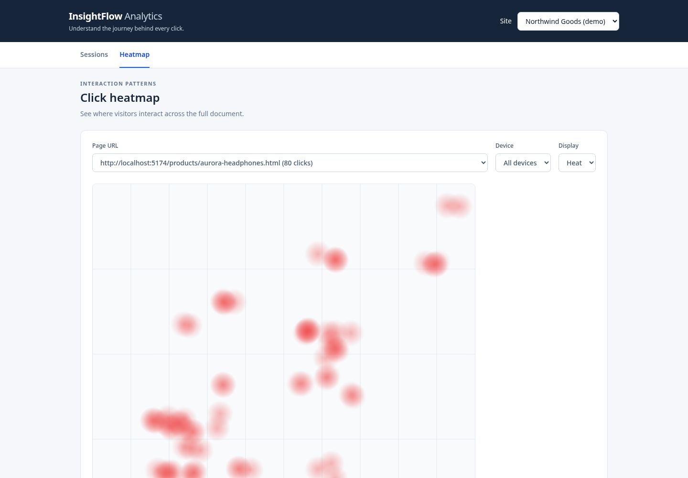

# InsightFlow Analytics

A complete User Analytics hiring assignment for CausalFunnel: a one-tag JavaScript tracker, an Express/MongoDB API, and a React dashboard for session journeys and click heatmaps. The demo store and seed data are synthetic. Local implementation and verification are complete; public publishing and hosted verification remain manual.

| Link | Status |
| --- | --- |
| Public GitHub repository | MANUAL: create repository and replace this placeholder |
| Dashboard | MANUAL: `https://<dashboard>.vercel.app` |
| Demo store | MANUAL: `https://<demo>.vercel.app` |
| API | MANUAL: `https://<api>.onrender.com` |
| Local dashboard / demo / API | `http://localhost:5173` / `http://localhost:5174` / `http://localhost:5000` |

## Features

- Single script tag records page views and capture-phase clicks with site/session/event IDs, normalized URLs, UTC timestamps, document coordinates, and dimensions.
- Sliding 30-minute localStorage sessions; in-memory fallback when storage is blocked; guarded tracker callbacks and silent transport failures.
- Validated, idempotent ingestion with origin checks, 10 KB limit, future-time rejection, and rate limiting.
- Paginated sessions with event counts, clickable chronological journeys, site selector, and page selector.
- Canvas heat/dots modes, desktop/mobile filters, and loading/empty/error states.
- Northwind Goods: a fictional, responsive 15-page store with product galleries, persistent cart, and fake checkout.
- Thirty idempotent historical sessions with funnel drop-off, plus a seeded Playwright shopper simulator driving the real tracker.
- MongoDB integration tests, generator/cart/simulator unit tests, and repeatable desktop/mobile Chromium verification.

## Architecture

```text
Any webpage + tracker.js ── POST /api/events ──► Express API ──► MongoDB
React dashboard          ── GET /api/sites… ──► Express API ◄── MongoDB
Northwind Goods (15 static pages) loads /sdk/tracker.js from the API
Playwright shopper personas click the store → real tracker → same API
```

```text
apps/api/           Express, Mongoose models, validation, queries, seed, tests
apps/api/public/    Committed esbuild tracker bundle, served at /sdk/tracker.js
apps/dashboard/     React + Vite + Tailwind dashboard
apps/demo-site/     Product data, static generator, cart, fake checkout, traffic simulator
packages/tracker/   Vanilla JavaScript tracker source and esbuild configuration
verification/       Live curl, Chromium, and Git-history secret-pattern checks
```

Each application has its own package/lockfile. There are **no npm workspaces**. The root package only provides quality-check convenience scripts.

## Tech stack

| Technology | Reason |
| --- | --- |
| Vanilla JS + esbuild | Small dependency-free tracker runnable on ordinary webpages |
| Node.js 20+ + Express 5 | Simple HTTP API and automatic forwarding of async errors |
| MongoDB + Mongoose | Structured documents, compound indexes, and aggregation queries |
| Zod | Request validation with readable 400 errors |
| React + Vite | Small component-based dashboard and production build |
| Tailwind CSS | Consistent responsive layout without a component library |
| Vitest + Supertest | Validator tests and API requests against real MongoDB |
| Playwright Chromium | Optional browser verification of real tracker and dashboard behavior |
| Helmet + CORS + express-rate-limit | Cross-origin script serving, browser origin policy, bounded ingestion |

## Local setup (Fedora)

Prerequisites: **Node 20.19+ or Node 22.12+**, npm, Git, Python 3, and Podman or an existing MongoDB instance. Verified on Node 22.23.1/npm 10.9.8. The dashboard tooling sets a slightly higher minimum than the assignment's generic Node 20 requirement.

On Fedora, if prerequisites are missing:

```bash
sudo dnf install -y nodejs npm git python3 podman
node -v
npm -v
```

### 1. Get the repository and keep caches local

Replace `<public-repo-url>` after publishing; until then an existing local Git checkout can be cloned with `git clone /absolute/path/to/checkout insightflow-analytics`.

```bash
git clone <public-repo-url> insightflow-analytics
cd insightflow-analytics
export npm_config_cache="$PWD/.cache/npm"
```

Run subsequent setup commands from this root unless a `cd` is shown. Keep this cache variable in the terminal during installation. Additional terminals should start at the repository root.

### 2. Start MongoDB

```bash
podman run -d --name mongo -p 27017:27017 docker.io/library/mongo:7
```

If already created, use `podman start mongo`. If port 27017 is occupied by an existing MongoDB instance, use that instance instead. Do not stop unrelated services. A local installation or Atlas URI also works; update `MONGODB_URI` accordingly. The default local database is `insightflow`.

### 3. Install and seed the API

```bash
cd apps/api
cp .env.example .env
npm ci
npm run seed -- --reset
cd ../..
```

`--reset` deletes **only events for `demo_store`** before creating 30 historical synthetic sessions (436 events). Without it, seeding is idempotent for the same primary origin: existing seed event IDs are preserved and only missing events are inserted. Both modes update the demo site’s allowed origins. Run without `--reset` to preserve tracked/simulated events. Changing the first `DEMO_ORIGINS` entry creates a separate seed namespace with that origin’s page URLs.

API environment:

| Variable | Local value / purpose |
| --- | --- |
| `PORT` | `5000` |
| `NODE_ENV` | `development` |
| `MONGODB_URI` | `mongodb://127.0.0.1:27017/insightflow` |
| `DASHBOARD_ORIGIN` | `http://localhost:5173`; comma-separated exact dashboard origins supported |
| `DEMO_ORIGINS` | `http://localhost:5174`; comma-separated exact origins used by the seed |
| `MONGODB_TEST_URI` | `mongodb://127.0.0.1:27017/insightflow_test`; separate destructive test database |
| `TRUST_PROXY` | `0` locally, `1` behind Render's proxy |

Origins include scheme and port, with **no path or trailing slash**. Open the demo with `localhost`, rather than `127.0.0.1`, to match the allowlist. `.env` files are ignored by Git.

Install the API **from `apps/api`**, as shown: its `.npmrc` disables optional-peer resolution that crashes npm 10 with Vitest's optional devtools peers. Required dependencies are explicit, locked, audited, and tested.

### 4. Install the dashboard, tracker, and demo tooling

```bash
cd apps/dashboard
cp .env.example .env
npm ci
cd ../../packages/tracker
npm ci
npm run build
cd ../../apps/demo-site
npm ci
npm run build
cd ../..
```

Dashboard `.env`: `VITE_API_URL=http://localhost:5000`. This is a public build-time setting, never a secret. Changing it requires restarting Vite or rebuilding the deployment.

The built tracker is already committed. Rebuild after any source edit using `cd packages/tracker && npm run build`; commit `apps/api/public/tracker.js` with the source change. The API deployment needs no separate tracker build.

### 5. Run each service in a separate terminal

Terminal A, from the repository root:

```bash
cd apps/api
npm run dev
```

Terminal B, from the repository root:

```bash
cd apps/dashboard
npm run dev
```

Terminal C, from the repository root:

```bash
python3 -m http.server 5174 --directory apps/demo-site
```

Wait until Terminal A prints `API listening on 5000` and Terminal B prints Vite’s ready message before making requests. Open `http://localhost:5174`, click and scroll, then reload `http://localhost:5173`. Select a session button to see its journey. Open Heatmap, choose a page, and switch Display to Dots. Reads are on-demand; reload the dashboard for newly collected events.

### 6. Verify and build

With the API and MongoDB running, from the root:

```bash
curl http://localhost:5000/api/health
python3 verification/api-smoke.py
```

The smoke script uses curl and Python assertions to verify all query routes and ingestion status codes. It adds one synthetic page-view session. Expected health: `{"status":"ok"}`; expected smoke ending: `PASS: all live curl assertions`.

Install root quality tooling and execute checks:

```bash
npm ci
npm test
npm run lint
npm run format
npm run build
python3 verification/secrets.py
```

`npm test` runs both the API and demo suites; it needs MongoDB. Tests use a database ending in `_test` distinct from `MONGODB_URI`, clean it between cases, and drop it afterwards. Never use a production database as `MONGODB_TEST_URI`. Currently 41 Vitest tests cover ingestion, validation, duplicates, counts, ordering, origin/CORS, limits, heatmaps, and historical funnels. Five Node test cases additionally cover generated pages/API URL rewriting, cart validation/totals, simulator flags/reproducibility, and rate-gate pacing/backoff. Browser journeys are separate live integration checks.

Production dashboard output is `apps/dashboard/dist`. For a local production preview, stop the dashboard dev server, then run `cd apps/dashboard && npm run preview` on port 5173.

### Optional automated browser QA

From the root, install isolated verification tooling and a browser:

```bash
cd verification
npm ci
cd ..
export PLAYWRIGHT_BROWSERS_PATH="$PWD/.cache/browsers"
npm exec --prefix verification -- playwright install chromium --no-shell
```

Fedora may show a Playwright unsupported-OS warning; full Chromium ran successfully here. Browser system libraries must be available. `--no-shell` avoids an unnecessary headless-shell download; the checks explicitly use the full Chromium channel.

Keep the demo server running. **Stop the API first**, since the tracker check owns and actually stops/restarts its API process on port 5000:

```bash
node verification/tracker-browser.mjs
```

This check uses default local MongoDB `insightflow`, default ports, and the seeded demo site. Restart the API with `cd apps/api && npm start` in another terminal afterward. With the dashboard and API running:

```bash
node verification/dashboard-browser.mjs
node verification/store-browser.mjs
node verification/shopper-dashboard.mjs
```

The original dashboard check uses live seed data plus intercepted responses for loading/empty/error cases; its screenshots go to ignored `verification/artifacts/`. The store check verifies both viewport purchase flows against MongoDB, every page, cart/error states, CSP and request destinations. The shopper dashboard check verifies long journeys, pagination, all page options, tall canvas pixels and device filters. Run it after seeding or simulation; it needs a journey with at least six views and 15 clicks. The two new checks refresh the committed `docs/screenshots/` images, so screenshot changes after a new workload are expected. Chromium checks were executed. Firefox and the hosted flow have **not** been verified.

## Northwind Goods demo store

The committed HTML works immediately with the Python server; no browser framework or build step is required to serve it. Pages are `/`, `/shop.html`, `/cart.html`, `/checkout.html`, `/order-confirmation.html`, `/about.html`, `/contact.html`, and eight `/products/<slug>.html` pages: `aurora-headphones`, `field-backpack`, `ceramic-mug`, `trail-bottle`, `linen-throw`, `desk-lamp`, `canvas-sneakers`, `merino-beanie`.

Shop category/search filters and sorting stay on the same pathname. Product pages have local SVG galleries, colors/sizes, quantities, tabs, FAQs and related products. The bag persists across pages; prices use integer cents, quantities are capped at 20 per variant, and DEMO10 gives a rounded 10% discount. Checkout only previews fixed fictional details and clears the bag on confirmation. The footer makes clear that no real orders exist.

`apps/demo-site/data/products.json` is the single product source (prices in cents). `scripts/build.js` and `templates/page.html` generate **all** pages, keeping header/footer/tracker/CSP consistent. After changing data or templates, regenerate and commit the HTML:

```bash
npm run build --prefix apps/demo-site
# Deployment example: origin only, no /api suffix or trailing path
DEMO_API_URL=https://your-api.onrender.com npm run build --prefix apps/demo-site
# Restore localhost HTML before local QA
npm run build --prefix apps/demo-site
```

`DEMO_API_URL` defaults to `http://localhost:5000`. Its value must be an HTTP(S) origin without credentials, query, hash or path. It rewrites both tracker attributes and the restrictive meta CSP. The site uses system fonts, shared local CSS/JS/JSON and inline SVG art; no CDN assets are needed. Store interactions remain available when the analytics API is down, with the SDK’s existing silent-failure behavior.

## Traffic simulator

Start MongoDB, API and demo using the setup above. Install Chromium once (same full-browser download as verification):

```bash
export PLAYWRIGHT_BROWSERS_PATH="$PWD/.cache/browsers"
npm exec --prefix apps/demo-site -- playwright install chromium --no-shell
npm run simulate --prefix apps/demo-site -- --sessions 40 --seed 42
# Custom local origin / debugging example (headed needs a graphical display)
npm run simulate --prefix apps/demo-site -- --sessions 5 --base-url http://localhost:5174 --concurrency 2 --seed 7 --headed
```

Keep `PLAYWRIGHT_BROWSERS_PATH` exported in the terminal running simulation/browser checks. The dashboard is optional while generating traffic; reload it afterward to see newly stored events. A full run takes several minutes because each shopper pauses and scrolls.

| Flag | Default | Meaning |
| --- | --- | --- |
| `--sessions N` | 40 | 1–500 shopper visits, each in a fresh browser context |
| `--base-url` | `http://localhost:5174` | Your demo’s local HTTP(S) origin; localhost/loopback only |
| `--concurrency N` | 3 | 1–5 simultaneous shoppers sharing one ingestion budget |
| `--seed N` | 42 | Unsigned 32-bit seed for persona/action choices |
| `--headed` | Off | Show Chromium for debugging |

Weighted personas: bounce 22%, researcher 26%, buyer 18%, abandoner 17%, mobile 17%. Viewports also vary within other personas. Shoppers click/tap real elements at varied offsets, pause, scroll in steps, explore galleries/options/tabs/FAQs, and sometimes click non-interactive copy. Researchers visit multiple products; buyers finish fake checkout; abandoners leave the bag; mobile shoppers use the hamburger menu. Some returning visitors expire the stored session timestamp by 31 minutes, exercising rotation without changing event timestamps.

The simulator only permits your local demo and its local SDK/API; remote targets and ingestion redirects are blocked. Playwright forwards the **original tracker-generated requests unchanged** through a shared 350 ms gate (at most 172/minute) to settle keepalive requests reliably across navigation. This pacing layer belongs to the simulator, not the SDK. A 429 pauses all workers for at least 60 seconds/Retry-After and increases spacing; the rejected event is reported, not retried. Other traffic on the same IP shares the API’s 300/minute limit, so avoid overlapping heavy browser QA or multiple simulator processes.

The final `SUMMARY` prints completed visits, persona counts, accepted events, 429s, failures, rotations, tracker session IDs, and peak requests/minute. Nonzero failures or no accepted events give a failing exit status. Forty visits can create more than 40 tracker sessions due to deliberate rotation. The verified seed-42 run produced 667 stored events across 43 tracker sessions, all five personas, zero failures/429s and a peak of 160/minute; see [simulation evidence](docs/simulation-report.json). This is an executed example, not a promise that all future timings/counts are identical.

Historical seed traffic is generated directly into MongoDB with past timestamps and approximate layout hotspots. It covers all 15 paths, a desktop/mobile mix, and a home→shop→cart→checkout→confirmation funnel of 30→21→12→5→2 sessions. Simulation uses real browser/tracker clicks and current timestamps, providing measured document dimensions and coordinates. Use `npm run seed` without reset to preserve simulation; use `--reset` only when intentionally replacing demo data.

## Verified screenshots

These show synthetic seed/simulated data from executed local Chromium checks. The heatmap is an approximate coordinate canvas rather than a page screenshot overlay.






## Embed snippet

Add this **one tag** to any HTTP(S) page after creating a Site document with the matching ID and allowed origin. The seeded site works for the local demo:

```html
<script async src="http://localhost:5000/sdk/tracker.js"
  data-site-id="demo_store"
  data-api-url="http://localhost:5000/api/events"></script>
```

Use HTTPS API URLs on HTTPS host pages. `data-api-url` is optional: when absent it resolves `/api/events` against the tracker script URL. No dashboard or npm dependency is required on the host page. Only one tracker instance is supported per document. The SDK reads `document.currentScript` synchronously, posts `text/plain` with `keepalive`, omits credentials, and uses a capture listener. Dynamic SPA history navigation is outside this implementation's scope; use full page navigation.

## API reference

Base URL: `http://localhost:5000`. Read APIs are unauthenticated; browser CORS is limited to `DASHBOARD_ORIGIN`. Ingestion CORS is open without credentials, and the handler checks Origin against each Site. Requests without Origin are allowed for curl/server clients. CORS is not authentication.

| Method / route | Parameters | Success example |
| --- | --- | --- |
| `GET /api/health` | None | `200 {"status":"ok"}` |
| `POST /api/events` | JSON text body below | `202 {"ok":true}`; repeat ID: `200 {"ok":true,"duplicate":true}` |
| `GET /api/sites` | None | `200 {"sites":[{"_id":"demo_store","name":"Northwind Goods (demo)"}]}` |
| `GET /api/sites/:siteId/sessions` | `page=1`, `limit=20`; limit 1–100, page 1–1,000,000 | `200 {"sessions":[{"session_id":"…","event_count":3,"page_views":1,"clicks":2,"started_at":"…","last_seen_at":"…"}],"page":1,"limit":20,"total":30}` |
| `GET /api/sites/:siteId/sessions/:sessionId/events` | Site + session IDs | `200 {"session_id":"…","events":[{"event_id":"…","session_id":"…","event_type":"page_view","page_url":"http://localhost:5174/","timestamp":"…"}]}` |
| `GET /api/sites/:siteId/pages` | Site ID | `200 {"pages":[{"page_url":"http://localhost:5174/","views":30,"clicks":120}]}` |
| `GET /api/sites/:siteId/heatmap` | Required `url` (URL-encoded) | `200 {"page_url":"http://localhost:5174/","total_clicks":1,"clicks":[{"x":10,"y":1020,"viewport_width":1000,"viewport_height":800,"document_width":1000,"document_height":2000}]}` |

Example ingestion body (use the **current UTC timestamp** when testing):

```json
{
  "site_id": "demo_store",
  "event_id": "550e8400-e29b-41d4-a716-446655440001",
  "session_id": "550e8400-e29b-41d4-a716-446655440002",
  "event_type": "click",
  "page_url": "http://localhost:5174/",
  "timestamp": "2026-10-12T04:00:00.000Z",
  "click": {
    "x": 10, "y": 1020,
    "viewport_width": 1000, "viewport_height": 800,
    "document_width": 1000, "document_height": 2000
  }
}
```

`page_view` has the same base fields and does not require `click`. IDs: event UUID; session string 8–100 characters (the tracker emits UUIDs); site 1–100 characters. Coordinates are nonnegative numbers up to 100,000; dimensions positive integers up to 100,000. HTTP(S) page URLs have a 2048-character limit and normalize to origin + pathname on the server too. Timestamp is ISO UTC; more than five minutes ahead of the server is rejected. Unknown fields are stripped.

Errors are JSON `{ "error": "…" }`: `400` invalid JSON/payload/query/future time (Zod adds `details`), `403` forbidden ingestion Origin, `404` unknown site/session/route, `413` body over 10 KB, `429` over 300 ingestion requests/IP/minute, `500` unexpected server failure. Duplicate IDs still undergo site/origin/payload checks before returning success. Read CORS restrictions omit permission headers for unapproved origins rather than returning 403; non-browser clients can still read.

Sessions sort by last seen descending, then session ID; journeys sort by timestamp ascending, then MongoDB `_id`. Heatmaps return the latest 5,000 clicks ordered by timestamp and `_id` descending, plus the uncapped `total_clicks`. Device filtering is applied to this capped set in the dashboard.

## Data model and indexes

`sites`: string `_id` (public site ID), required `name`, `allowed_origins` string array, `created_at` date.

`events`: MongoDB `_id`, `site_id`, UUID `event_id`, `session_id`, enum `event_type` (`page_view`/`click`), normalized `page_url`, Date `timestamp`, server Date `received_at`, and optional `click` subdocument (x/y, viewport width/height, document width/height). Click subdocuments do not have their own `_id`.

| Event index | Purpose |
| --- | --- |
| `(site_id, session_id, timestamp)` | Site/session journey lookup and timestamp ordering |
| `(site_id, page_url, event_type)` | Page-specific click lookup and page queries |
| Unique `(site_id, event_id)` | Idempotent inserts, including concurrent duplicate requests |

The API initializes indexes before listening. Sessions are aggregated from events, with separate total session counting. No separate session collection or TTL deletion is configured.

## Assumptions, trade-offs, and known limitations

- A session means one browser on one site with less than 30 minutes between tracked events. Activity at exactly 30 minutes creates a new session. Only page views/clicks extend it; passive scrolling alone does not. localStorage shares the session across tabs; concurrent initialization can race. Storage-blocked fallback lasts only for that document's lifetime.
- Origin plus pathname drops query strings and fragments to avoid collecting sensitive parameters. Query-only variants merge, while trailing slashes and `.html` paths remain distinct.
- Site IDs are public. Origin checks deter casual browser misuse; forged or absent headers are possible, so they are **not authentication**. Rate limiting is in-process per IP, shared by all sites and visitors behind that IP, and resets when the API restarts.
- Read APIs have no authentication because the assignment demo is synthetic. Browser CORS is not access control for server clients. Add authentication before collecting real visitor data.
- Individual fetch requests use keepalive with no batching or retry queue. Network failures, unavailable APIs, navigation timing, browser/ad blocker policies, and cold starts can lose events. Transport failure is silent; native browser network diagnostics may still appear.
- Heatmaps scale each point using its own document dimensions onto an 800 px canvas, with a median layout ratio and height capped at 4000 px. Responsive layouts move content, so this is approximate. Desktop is viewport width ≥768; mobile is below 768. It is a dots/soft-gradient grid, not a screenshot overlay.
- Sessions use aggregation rather than a separate collection, keeping counts consistent with event storage. Large datasets need materialized summaries/retention and deeper pagination changes. Queries are bounded for sessions/heatmap; one session's full journey and page list are uncapped as requested.
- No consent banner, bot filtering, authentication system, retention policy, or SPA history patch.
- Northwind Goods is fictional: checkout/contact/newsletter show fixed readonly fake values, send no form contents, and place no real orders. No payments or personal data are collected. Cart quantities/options and the recognized DEMO10 code use `northwind-goods:*` storage keys, separate from tracker keys. Blocked storage falls back within the current document; persistence across navigation requires localStorage.
- Simulated shopper traffic is synthetic, only for demonstration. It uses the real tracker and actual current timestamps, while historical seed data is explicitly fabricated. Seeded choices are reproducible; concurrent completion order, event UUIDs, and wall-clock timestamps vary. No remote fonts/images/scripts are used by the store; only the configured first-party SDK/API is requested beyond the static origin.
- Every product/page has its own pathname because queries and hashes are stripped from tracked URLs. Client-side filters, tabs, galleries, and quantity changes generate clicks on the current page.
- Render free-tier services sleep when idle; first requests can take around a minute. Early events may be lost while the API wakes. This hosted behavior is a deployment consideration, not a result measured here.
- The SDK and local dashboard were tested in Chromium. Firefox, mobile hardware, and production hosting need the manual QA below.

## Manual QA checklist

- [ ] Fresh browser profile: load demo; one page view and a UUID at localStorage key `insightflow:demo_store:session`.
- [ ] Reload and navigate home → shop → product → cart; the session persists and page views appear.
- [ ] Click search and newsletter controls; bottom y exceeds viewport height. Tracker browser QA explicitly tests stopPropagation against the capture listener.
- [ ] Filter/sort shop; switch product thumbnails/options/tabs; add two headphones, reload, change quantities, apply DEMO10, and complete fake checkout. Verify cart totals, empty state, and responsive hamburger menu.
- [ ] Run the simulator; compare its accepted-event summary with the dashboard/API and inspect product heatmap device filters.
- [ ] Edit stored `last` to `Date.now() - 31 * 60 * 1000`; next click creates a different UUID.
- [ ] Stop API after tracker loads; host buttons still work without uncaught page errors.
- [ ] Block storage; events within one page keep the same fallback session.
- [ ] Compare session event count with MongoDB/API; click session and check journey order.
- [ ] Change page selector, Dots/Heat, and desktop/mobile filters; counts and canvas change.
- [ ] Verify loading, empty, and failed requests show clear state messages. Browser QA scripts exercise these with delayed/intercepted responses.
- [ ] In a private window, verify hosted demo → hosted dashboard in Chrome and Firefox after deployment.

## Deployment — MANUAL STEPS

No accounts were created, credentials entered, remote repository pushed, or hosted applications deployed. Follow the guide's dependency order:

1. **Create a public GitHub repository and push.** From this repository: `git remote add origin <public-repo-url>` then `git push -u origin main`. Source, lockfiles, committed tracker, and this README are ready. Update the link table after publication. Do not push `.env` or credentials.
2. **MongoDB Atlas:** create a free M0 cluster and database user. Under Network Access allow `0.0.0.0/0` as in the guide (Render free tier has no fixed IP). Copy the connection string with database name `insightflow`, using the user's encoded password. Keep it only in local environment/Render secrets.
3. **Seed production data** from `apps/api` using the Atlas URI and planned demo URL:

   ```bash
   MONGODB_URI='<atlas-uri>' DEMO_ORIGINS='https://<your-demo>.vercel.app,http://localhost:5174' npm run seed
   ```

   No deployment URL exists yet; substitute your actual planned/assigned URL. Rerun this after the demo URL is known. It updates allowed origins and inserts only missing historical seed events; add `-- --reset` only if deleting existing demo events is intended. Seed URLs use the first origin.

4. **Render API:** create a Web Service from the GitHub repo. Root Directory `apps/api`; guide Build Command `npm install`; Start Command `npm start`; Health Check Path `/api/health`. The included `render.yaml` uses reproducible `npm ci --omit=dev`, equivalent for this runtime, and needs no cross-directory SDK build.

   Set `MONGODB_URI=<atlas-uri>`, `NODE_ENV=production`, `NODE_VERSION=20`, `TRUST_PROXY=1`, and temporary `DASHBOARD_ORIGIN=http://localhost:5173`. Render supplies `PORT` (blueprint defaults to 10000). `DEMO_ORIGINS` is used when running seed locally, not during API requests. Confirm `https://<api>.onrender.com/api/health` and `/sdk/tracker.js` load; the tracker response must include `Cross-Origin-Resource-Policy: cross-origin`.

5. **Vercel dashboard:** import the same repo with Root Directory `apps/dashboard`, framework Vite, Install Command `npm ci`, Build Command `npm run build`, Output Directory `dist`. Set `VITE_API_URL=https://<api>.onrender.com` before building. The project contains `vercel.json` with build/output settings. No authentication tokens belong in `VITE_` variables.
6. **Vercel demo:** create a second project with Root Directory `apps/demo-site`, framework Other, Install Command `npm ci`, Build Command `npm run build`, Output Directory `.`. Set **`DEMO_API_URL=https://<api>.onrender.com`** before building. The generator writes the identical tracker `src`, `data-api-url`, and CSP API origin into all 15 pages automatically. Do not hand-edit generated HTML. The included `vercel.json` preserves `.html` URLs (`cleanUrls: false`) to match tracked and seeded paths. Playwright is a development tool; Vercel does not need to install a browser or run simulation.
7. **Connect origins:** set Render `DASHBOARD_ORIGIN` to the exact dashboard Vercel origin (optionally comma-separate `http://localhost:5173`). Rerun production seed with the actual demo Vercel URL first in `DEMO_ORIGINS`, so page URLs and allowed Origins match. Redeploy/restart affected services after environment changes.
8. **Verify hosted flow:** visit the hosted demo, click/scroll/navigate, find the new session and ordered events in the hosted dashboard, and inspect heatmap dots. Check both Chrome and Firefox/private windows. Update live links and submission notes only after seeing it work.

`render.yaml` and both `vercel.json` files are configuration preparation; actual provider deployment is **unverified** until the human performs these steps.

## Troubleshooting

| Symptom | Check |
| --- | --- |
| MongoDB port/name conflict | Use existing MongoDB or `podman start mongo`; do not create a second service on the same port |
| API startup fails | MongoDB reachable, correct URI/database, install from apps/api, see startup error |
| Ingestion 403 | Re-seed with exact demo origin; hostname, scheme and port must match |
| Dashboard fetch fails | Correct API URL and DASHBOARD_ORIGIN; Vite env changes require restart/rebuild |
| Tracker blocked by response | Preserve Helmet cross-origin CORP setting |
| HTTPS demo has no events | Use HTTPS tracker/API URLs to avoid mixed content |
| Empty heatmap | Selected page URL matches data; check .html/trailing slash and device filter |
| Delayed hosted response | Wait for Render cold start; reload dashboard/demo |
| npm edgesOut resolution crash | Run npm ci from apps/api so its .npmrc is applied |

## Future work

Authentication and site ownership, consent controls, bot filtering, retry/batching, SPA route integration, retention, materialized session summaries, screenshot overlays, and cross-browser CI. These are intentionally outside the assignment's current scope.

## Verification record and guide corrections

See [PROGRESS.md](PROGRESS.md) for executed commands, real outcomes, phase commits, failed checks and fixes, and continuation instructions. The original 34-page guide is in `docs/` alongside its extracted text.

Corrections: initialize duplicate-protection indexes before listening; guard each asynchronous tracker callback; validate corrupt session state; put the scroll-test button at the actual bottom; normalize HTTP(S) URLs on ingestion/query and catch malformed URL errors; show page loading explicitly; avoid stale dashboard responses; sample seed click count once per page; use patched test tooling and Node's watch mode. Optional guide SPA patching was omitted to keep host-page interference and scope small. Node minimum is documented for selected tooling. The session model/reasoning cannot be changed through these tools, so the requested GPT-6.1 Sol/Medium setting is not asserted as verified.
